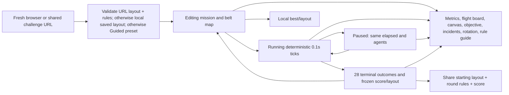

# Gateflow cross-view consistency and first-use acceptance plan

**Scope:** actual Gateflow single-page game, PR #17. There are **no daily/weekly/monthly menus or separate application tabs** in the inspected source tree. Do not fabricate tests for meal-planning or scheduling features in this repository; identify that separate app/repo before changing it.

## Source of truth and screens



State owners: `roundId` selects schedule; `edges` is the mutable base belt layout; `sim` owns agent stages, counters, faults, elapsed and R06 edit token; `startingLayout` is the immutable share input when live editing occurs; `selected` and the board cursor are transient input states. `finished`, `active`, `resolved`, `score`, `displayEdges`, `nextWave`, `flowMood` and the debrief are **derived**. Persist only the already-supported browser-local fields.

## Cross-view inspection after every action

For each case, observe **all** simultaneously displayed regions, not merely the action target: top status, four metric cards, mission selector, pace/preset controls, landing schedule, R06 token banner, challenge ribbon, board and post controls, objective and outcome counters, queue-stay/switch counters, incident feed, staff handovers, instructional panel, debrief/score ledger, share controls, and saved best after refresh.

| Step | Trigger + state transition | Must agree across all regions | Negative/counterfactual |
| --- | --- | --- | --- |
| U01 | Fresh, no URL and no `localStorage` | Guided/classic, editing, 00:00, 0 arrived/cleared, board fingerprint matches visible belts | Seed malformed storage: no crash/invalid geometry |
| U02 | Open valid R04/R05/R06 challenge | Imported initial geometry, matching mission and rule version, target score shown without invented server record | Invalid version/score: no comparable score; encoded invalid belts rejected |
| U03 | Switch mission, then each of three presets | Schedule/label/rank/best are mission-correct, sim reset, selection cleared, no stale incident or R06 token | Switch while running must be denied, including at elapsed exactly 0 |
| U04 | Select adjacent posts; remove; attempt diagonal and cross-zone | Fingerprint, graphic, selection and Spanish message match real connection status | Reciprocal duplicate or noncanonical IDs rejected |
| U05 | Start, observe first tick, change pace ½→2× | Start/elapsed/counters/disabled controls consistent; speed affects wall-clock only | Equal seed and layout produce equal terminal score |
| U06 | Pause, inspect worker fault, resume | Frozen time when paused; fault flag and planned purser repair reflected in belt/score/incident/rotation | Resume after background tab must be explicit; cannot edit ordinary belts |
| U07 | Background the running tab and return | Auto-paused with a truthful explanation; elapsed does not advance invisibly | Remove visibility listener: test must detect unintended clock advance |
| U08 | R06 13.9→14.0; choose one visible belt | Banner unlocks at 14; clock must read 00:14; one token spent only after actual opening; score rules unchanged | Fault-open belt cannot consume token; rapid double-click cannot spend twice |
| U09 | Finish with exactly 28 terminal passengers | Status finished; score ledger equals component sum (clamped), outcomes and remaining agree, board frozen | Canvas clicks at debrief do not change result fingerprint; no hidden modal edits |
| U10 | Open ledger, copy/share, cancel native share | Scorecard URL has right starting layout, round/rules, target; canceled share does not auto-copy | Tampered score/version, denied clipboard permission, double click |
| U11 | Debrief → adjust → replay and reload page | New run resets score/tick/token while keeping intended editable layout; prior comparable score visible | Don't compare scores across different missions as same experiment |
| U12 | Two tabs open to one origin, edit each | **KNOWN CONSISTENCY GAP TO VALIDATE:** `storage` event isn't handled, so the first tab need not reflect edits from another. No assertion of live synchronization. | Check last-writer-wins and reload. Define policy before enabling collaborative semantics |

## State oracle applied at each simulated tick

```text
0 <= spawned <= 28
awaitingArrival + spawned == 28
spawned == active + cleared + failed + turnedAway + abandoned
resolved == cleared + failed + turnedAway + abandoned
remaining == 28 - resolved
finished iff spawned == 28 and resolved == 28
R06 breathEdits in {0, 1}; all non-R06 breathEdits == 0
score == clamp(round(sum(scoreLedger parts)), 0, 1000)
FIFO per lane, unique queueSequence and event IDs
UI displayed wall-clock second == floor(exact tick / 10)
```

## Four non-overlapping red-team passes

1. **Math:** 28-passenger conservation on every 0.1s tick, arrival boundary, worker closures, no duplicate service, no hidden score points; compare to independent integer-tick oracle.
2. **State/adversarial:** start at 0, pause/resume/reset on 14s boundary, rapid R06 edits, stale selection, malformed URL/localStorage, background tab and replayed share.
3. **Human experience:** viewport matrix, horizontal pan and pointer position, 200% text zoom, alternate 44px controls, visual status announcement, keyboard/tab order, reduced motion, real iOS Safari/VoiceOver/OS share.
4. **Release:** exact branch SHA → hosted CI → screenshot/NDJSON inspection → independent review → physical/novice UAT → tested Pages build → live version and asset fingerprint check; never infer passing devices from Chrome.

## Defect and evidence register, 22 Nov

| ID | Finding and root cause | Fix / actual verification | Gate |
| --- | --- | --- | --- |
| CV-01 P1 | `timeLabel` floors repeated floating-point additions: tick 140 can hold `13.999999999999966`, displaying 00:13 while the R06 guard is open | Candidate uses pure `formatTickClock` for both user-facing clocks; test compares 1201 repeated additions against independent integer tick values and checks 14s/60s boundaries | **Committed, hosted CI pending** |
| CV-02 P1 | Two browser tabs write `localStorage` with no `storage` subscription or cross-tab authority | No fake DB lock. Decide single active editor vs per-tab independent drafts; add conflict/refresh UI only after product decision | **Open**, two-tab test not executed |
| CV-03 P1 | R06 draft lacks native physical touch/VoiceOver/200% zoom/share-sheet and novice acceptance | Simulated Chrome and CI cannot replace physical OS verification | **Blocked manual** |
| CV-04 P1 | Draft PR #17 has no independent reviews even though pre-change Actions CI passes; docs can incorrectly read as release-ready | Exact SHA review and fresh gate run after edits; keep draft | **Blocked review** |
| CV-05 P2 | User asks for daily/weekly/monthly menus that do not exist in this Gateflow repo | Locate correct app and inventory first-use transitions there; do not add meal/planning UI here | **Scope mismatch** |

Existing state-machine maps and detailed historical fixes: [`STATE_MACHINES.md`](./STATE_MACHINES.md) and [`STATE_MACHINE_AUDIT_LEDGER.md`](./STATE_MACHINE_AUDIT_LEDGER.md). Test commands and operational custody: [`STACK_INVENTORY.md`](./STACK_INVENTORY.md).
