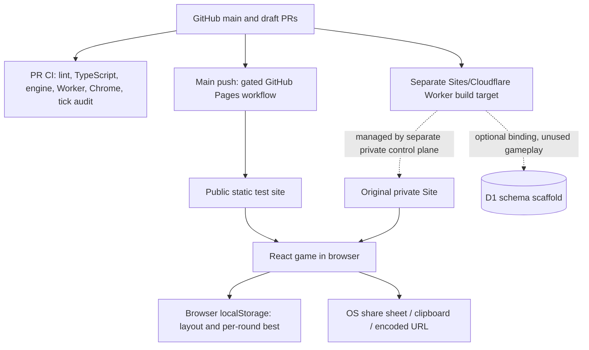

# Gateflow operational stack and provenance (verified 22 Nov 2026)

This inventory is **about `PillB/gategame` only**, not another application that may use daily, weekly or monthly menus. It differentiates source-level capability, hosted CI evidence, and live deployment evidence. Never expose credentials or infer a secret from a repository template.

| Layer / question | Verified location or owner | Actual role and limits | How to verify |
| --- | --- | --- | --- |
| Source and decisions | [GitHub: `PillB/gategame`](https://github.com/PillB/gategame), `main` | Public repository, static Pages test application plus separately built Sites/Worker target | GitHub repo metadata, `README.md`, `package.json` |
| Pending development | [Draft PR #17](https://github.com/PillB/gategame/pull/17), branch `feature/r06-breath-and-clock-clarity` | R06, tick audits, prior state-machine fixes; **not automatically on the public testing site** | Confirm PR head and CI on *that exact SHA* |
| Game UI and transition engine | `app/page.tsx` | Single-page React game; component-local `useState` and tick loop; stage/score/result views read a common `sim` snapshot | `tests/full-round.test.mjs`, `scripts/browser-smoke.mjs` |
| Pure domain modules | `lib/simulation.js`, `lib/rounds.js`, `lib/challenges.js`, `lib/round-experiments.js` | Routing, passenger/queue semantics, rounds and share contract; no network persistence | `tests/*test.mjs` |
| Public testing frontend | [GitHub Pages](https://pillb.github.io/gategame/) | Static build of the same component via `index.html`, `src/main.tsx`, `vite.pages.config.ts`; not a secure backend | [`static.yml`](../.github/workflows/static.yml), remote `/gategame/version.json` |
| Public CI and publishing | `.github/workflows/ci.yml`, `.github/workflows/static.yml` | PR checks do not publish; `main` push runs quality gates then publishes `dist/pages`. `pages.yml` is manual recovery only | [Actions](https://github.com/PillB/gategame/actions) and `scripts/verify-live-pages.mjs` |
| Historical/independent private Sites | `vite.config.ts`, `worker/index.ts`, `app/layout.tsx` | Original ChatGPT Sites/Vinext/Cloudflare Worker target; not managed by the Pages workflow | `docs/DEPLOYMENT.md`; private host details require its own control plane |
| Worker/async jobs | `worker/index.ts` | HTTP request adapter + image optimization; **no evidence of active gameplay job consumers**, background worker pool or queue | Source inspection; do not call the HTTP Worker an async task queue |
| Database | `db/index.ts`, `db/schema.ts`, `drizzle.config.ts` | Optional Cloudflare D1 binding scaffold, empty schema; **no active game database or proven deployed DB identifier** | Code and hosting-control-plane inspection if a DB is later enabled |
| Browser persistence | `window.localStorage` via `safeRead`/`safeWrite` in `app/page.tsx` | `gateflow-layout-v2`, `gateflow-best-v2`, `gateflow-best-<round>-waves-1`; browser-local only | Fresh/returning browser, storage unavailable and two-tab tests |
| Sharing | `lib/challenges.js` and UI `navigator.share`, clipboard | Encoded starting layout, bounded score, mission/rules version; no multiplayer server or message outbox | `tests/challenges.test.mjs`, browser smoke and physical share-sheet |
| Documentation | `README.md`, `AGENTS.md`, `CLAUDE.md`, `docs/` | `docs/GAME_SPEC.md`, `STATE_MACHINES.md`, `STATE_MACHINE_AUDIT_LEDGER.md`, `RELEASE_LEDGER.md`, `QA_LEDGER.md` | Review dated evidence vs live SHA; older ledger rows can be historical |
| Claude/agent sessions | `CLAUDE.md` points to `AGENTS.md` | Instructions exist; **no runtime session histories, active subagent roster or independent Claude execution records established** | Requires access to the separate agent session system |
| Vercel | No Gateflow-named Vercel project in the connected project search on 22 Nov | This does **not** prove that no private or unrelated Vercel project exists | Check ownership and project ID before any Vercel release |

## Runtime and delivery diagram

## Infrastructure decisions and falsifiable trade-offs

- **Do not add database connection pooling**: Pages is static; the optional D1 helper uses a platform binding, not a caller-managed SQL connection pool. An idle pool cannot solve a client state desynchronization.
- **Do not add a transactional outbox**: no persisted order, cross-service side-effect or queue delivery contract exists. If a future authenticated multiplayer share/score service writes to DB and publishes messages, introduce a persisted event/outbox with an idempotent consumer *then*.
- **Do not add database optimistic locking today**: no shared DB record exists. Browser tabs can nonetheless conflict through last-writer-wins `localStorage`; do not mischaracterize this as solved by D1. See [cross-view and multi-tab acceptance](./CROSS_VIEW_CONSISTENCY.md).
- **Do not automatically redeploy the private Site** from this public repository. Pages and Sites are separate source/deployment authorities.
- **Production readiness is not green CI**: current PR #17 has successful pre-change CI [43673490974](https://github.com/PillB/gategame/actions/runs/43673490974), but any new commit requires a fresh passing run. Independent review, real iPhone Safari/touch/VoiceOver, 200% zoom, OS share and novice UAT remain open.
- **Live verification caveat**: the automatic `main` Pages job reported success on [43673244563](https://github.com/PillB/gategame/actions/runs/43673244563) (15 Nov). External page access was unavailable to this audit; do not claim a newly observed live SHA without the `version.json` response.

## Minimal release protocol

1. Confirm target (public Pages test, **not** private Sites), exact PR head SHA, expected levels and review status.
2. Read `docs/STATE_MACHINE_AUDIT_LEDGER.md`; run `npm run lint`, `npm run lint:complexity`, `npm run typecheck:pages`, `npm test`, `npm run test:pages`, Chrome smoke and per-tick audit on the candidate SHA.
3. Review artifact screenshots against calculations, complete real-device and novice human gates, and secure independent review.
4. Only then mark the PR ready, merge intentionally, wait for `main` checks and Pages publisher, and independently verify live `version.json`, JS/CSS/fonts and all user flows.
5. If the exact live revision or behavior disagrees, **stop** and revert through a reviewed commit; keep the private Site untouched.
