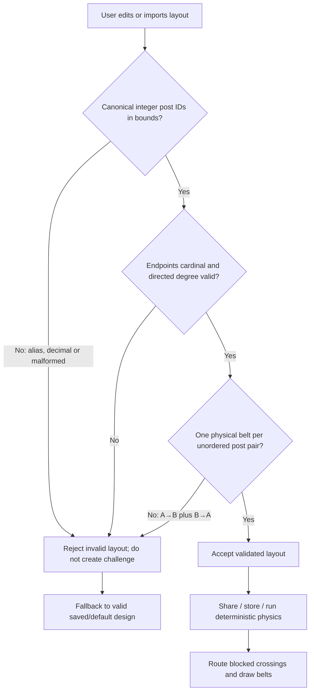
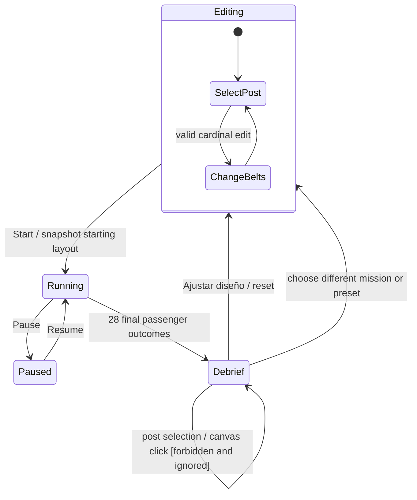
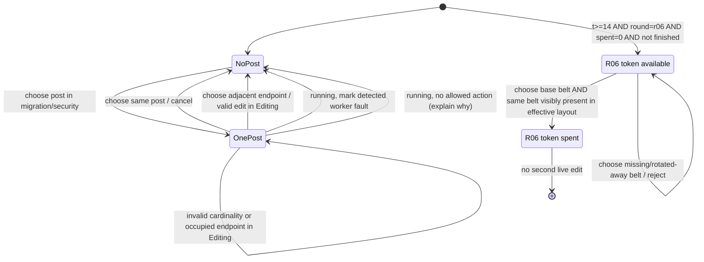
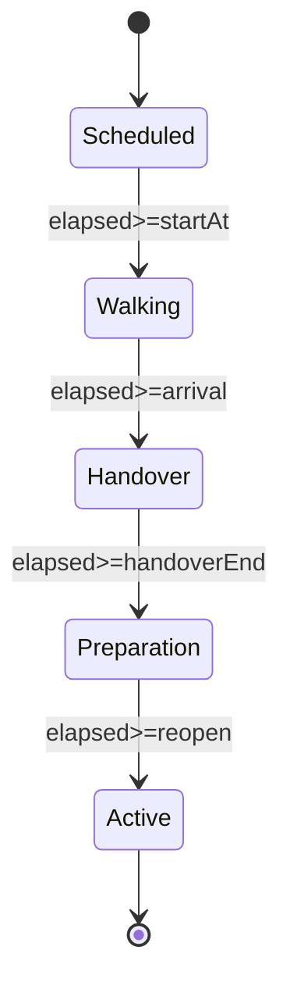
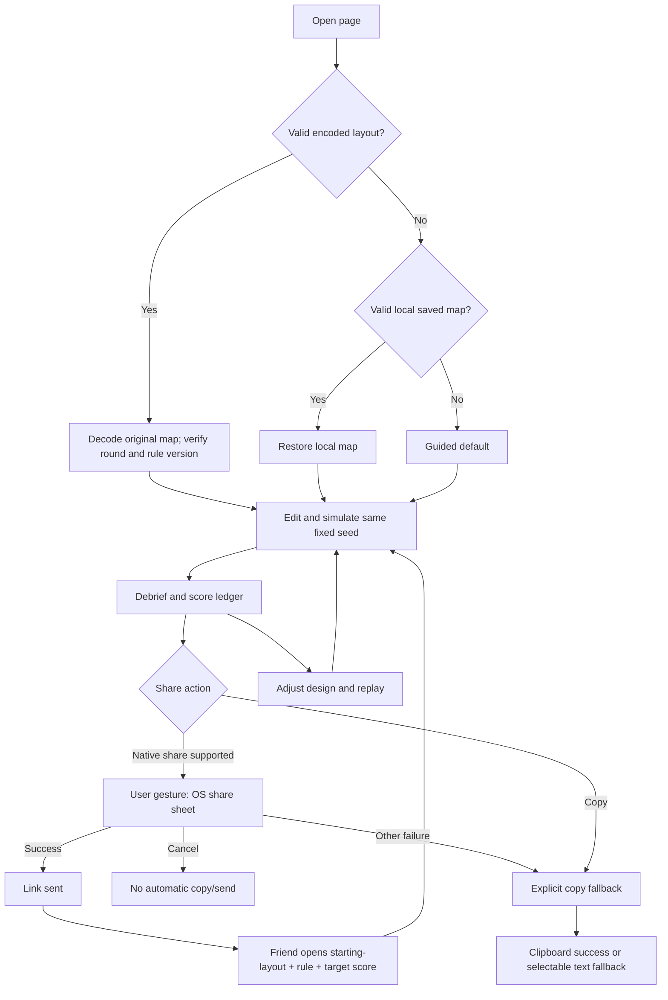
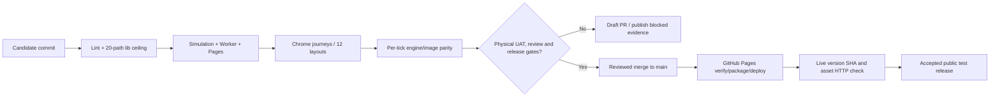

# Gateflow — implicit state machines and user-flow architecture

Audited 14 November 2026 from the R06 candidate in PR #17. This is a *source-derived design map*, not proof of real-world Safari/VoiceOver or human enjoyment. `docs/STATE_MACHINE_AUDIT_LEDGER.md` tracks conflicting, unreachable, redundant and unverified transitions. Diagram syntax: GitHub Mermaid.

## Boundaries, inputs, and version evolution

- **v5 Sites baseline:** airport belts obstruct corridor crossings. Static 15×12 post grid per zone and 14×11 walking cells. Two desks phases and deterministic passengers.
- **PR #10:** interpolated inter-lane walking, reservations and FIFO-on-arrival (replaces abandoned PR #6).
- **PR #13/main:** classic + R04 (four seven-person landings) + R05 (two fourteen-person landings), score feedback and a public *test* Pages build.
- **PR #17, draft:** R06 four seven-person waves 0/7/27/34, one optional *removal* of a visible belt after t=14s, honest scoring offsets, 12-profile mobile QA, clear debrief focus and responsive controls. Main/Pages is still R04/R05.
- There is **no slide deck** (`.ppt`, `.pptx`, or slide-output directory) in the inspected tracked tree. Visual evidence is GitHub Actions screenshots, not slides.
- Runtime domains: `app/page.tsx` React UI + engine, `lib/simulation.js` geometry/routing/score/queue selection, `lib/rounds.js` wave schedules/guards, `lib/challenges.js` share contract; static Pages `src/main.tsx`, original Sites Worker `worker/index.ts`. `db/index.ts` is optional D1 scaffold, not a current gameplay transaction boundary.

### S-1. Canonical layout import and physical-belt uniqueness (new negative-test state)

**Failure mechanism found 14 November:** an original `A→B` plus reversed `B→A` passed directed one-in/one-out checks while rendering and blocking the **same** physical segment twice. Imported post strings such as `01:1` could parse to a numeric post but could not be selected by the canonical canvas node `1:1`. Both are invalid states. New entry guards use canonical `nodeId(x,y)` equality and an **unordered physical edge key**; a single A→B or B→A is still valid by itself because directed endpoint ownership remains a real editing constraint.

**Trade-off:** malformed legacy imported layouts are **rejected**, not silently repaired, to avoid mutating challenge geometry and score provenance. Existing valid G1 layouts, round rules and seeds retain their original meaning. Negative oracle: traversability with [A→B] must equal traversability with [A→B,B→A], so the latter must never become an independently accepted game state. Exhaustively test 40 segments in a 5×5 lattice, plus a deliberately malformed URL in the real browser.

### S0. Overall player session: guard-driven, not a collection of unrelated buttons

```mermaid
stateDiagram-v2
  [*] --> Hydrating
  Hydrating --> Editing: URL or local layout validated; fallback preset
  Editing --> Running: Start [snapshot initial layout]
  Running --> Paused: Pause button
  Running --> Paused: document becomes hidden
  Paused --> Running: Resume
  Running --> Finished: spawned=28 AND resolved=28
  Paused --> Finished: forbidden unless already terminal
  Finished --> Editing: Adjust design
  Editing --> Editing: preset / edit pair / select mission
  Running --> Editing: Reset (fresh 0:00; preserve current layout)
  Paused --> Editing: Reset
  Finished --> Editing: Reset
  Running --> Running: 0.1s tick, pace changes only wall time
  Paused --> Paused: speed setting, inspect/flag worker faults
```

**Guards and contracts.** `finished` derives from terminal passenger counters, not an independent flag. `gameLocked` is derived from `sim.elapsed`, `sim.running`, and `finished`; R06 removal is an explicit guarded exception. A reset preserves the current belt configuration but clears the run/token. Merely changing pace is **not** supposed to change outcomes. `document.visibilityState=hidden` pauses to avoid time advancement under background timer throttling. The debrief receives keyboard focus on completion; a real focus-trap/screen-reader audit remains open.

#### Finished-state read-only invariant (SM-20)

The completed `score` and `layout fingerprint` are a single immutable *result snapshot*. A post edit directly from Debrief previously bypassed the intended `Ajustar diseño` transition because `gameLocked` became false at completion while the result panel remained visible. The board is now non-interactive in Debrief: disabled precise controls, unfocusable static canvas and an additional guard in `selectNode`. This is intentionally **not** an edit history/undo feature. The browser counterexample dispatches two well-formed post clicks after completion and demands an unchanged fingerprint and score; clicking `Ajustar diseño` must then restore editability. Valid mission/preset changes already reset the completed `sim` and remain available.

### S1. Passenger phase and retry automaton (28 independent agents)

```mermaid
stateDiagram-v2
  [*] --> Grid1: spawn at advertised arrival time
  Grid1 --> Choice1: valid A* corridor route reaches desk
  Grid1 --> Grid1: obstruction/fault changed / replan from current cell
  Grid1 --> Grid1: blocked / reverse to entry and try another distinct entry
  Grid1 --> Failed: entry options exhausted
  Choice1 --> Walk1: choose different nearby lane; reserve destination
  Choice1 --> Queue1: stay in current lane, FIFO sequence assigned
  Walk1 --> Queue1: physically arrive; FIFO sequence assigned
  Queue1 --> Left: patience threshold exceeded
  Queue1 --> Service1: first waiting, lane open and not busy
  Service1 --> Service1: worker closed or remaining service time > 0
  Service1 --> TurnedAway: adverse immigration outcome
  Service1 --> Grid2: accepted; new security grid route
  Grid2 --> Choice2: valid corridor path
  Grid2 --> Grid2: topology replan or return/retry
  Grid2 --> Failed: entries exhausted
  Choice2 --> Walk2: choose different lane
  Choice2 --> Queue2: stay / FIFO
  Walk2 --> Queue2: travel completed / FIFO
  Queue2 --> Left: patience exceeded
  Queue2 --> Service2: open desk / FIFO
  Service2 --> Done: service complete
  Done --> [*]
  Failed --> [*]
  TurnedAway --> [*]
  Left --> [*]
```

**Invariants:** `spawned = active + cleared + failed + turnedAway + abandoned`; `awaitingArrival + spawned = 28`; no service before a `walk` completes; queueSequence monotone and assigned on arrival; no passenger may occupy two service lanes or terminal states; physical corridor crossing must be unblocked when traversed. Retry is bounded by the distinct entry list, not an infinite reroute. UI sprites interpolate route and lane position from these states; the CSS `prefers-reduced-motion` media query disables purely decorative animations but not simulation logic.

### S2. Player's belt selection, live R06 exception, and fault repair

```mermaid
stateDiagram-v2
  [*] --> BaseBelt
  BaseBelt --> Faulted: worker crosses; fault opens or rotates belt
  Faulted --> Flagged: player selects original/applied endpoints
  Flagged --> Repaired: purser in patrol state AND line-of-sight/FOV match
  Flagged --> Flagged: purser outside view, break or chat
  Faulted --> Faulted: player selects unrelated endpoints
  Repaired --> BaseBelt: effective layout recomputed from base + outstanding faults
```

**Race hazards:** `sim.breathEdits` and `breathSpentRef` jointly prevent two rapid clicks; **do not delete** the ref just because it mirrors a counter—first test fast double taps and synchronous render windows. Effective belts are recomputed from the base plus unrepaired faults, not persisted into the base. A fault removed an edge visually, so the R06 action must reject attempts to spend the token opening that same already-open crossing. A fault marker is a conditional intervention, not an immediate repair.

### S3. Worker shifts, incident feed, and render clock

Worker stage is **derived from elapsed time**; there is no second authoritative worker-status object to synchronize. During `Handover` and `Preparation` the lane cannot start or advance service. A worker can create at most one fault because `faultedWorkers` remembers processed worker IDs. Purser state is a 26-second deterministic patrol/break/chat cycle; repairs require marked faults plus visibility and patrol. Event feed displays **3 latest** items although the engine currently retains 8; verify other consumers before removing that extra history.

### S4. Shared challenge, storage, and repeat loop

A shared R06 challenge with a live edit must encode the **initial** layout, not the final modified one, so the recipient can choose their own timing/removed belt. Invalid or incompatible round/rule combinations must never claim comparable results. Browser storage contains only the local layout and best score; no server queue or external outbox currently exists. Clipboard/native share can fail due browser permissions; canceling is a legitimate no-op.

### S5. Build/release state (separate from gameplay)

The public repository has no active DB writes, brokers, or multi-user shared mutable records. Do **not** introduce pooling, outbox, distributed locks or server synchronization without a new requirement and a failure scenario proving the need. The Cloudflare D1 helper is optional scaffold. Native fullscreen/200% pinch zoom and actual iOS Web Share require device tests; Chrome viewport emulation alone cannot certify them.

## Distinguish state from derived views

| Mutable source | Derived state/view | Risk if duplicated |
| --- | --- | --- |
| `sim` counters, `running`, `elapsed`, `breathEdits` | finished, locked, editable, remaining, score, medals | Conflicting “running but unlocked” and double token spending |
| `edges`, `sim.faults` | `effectiveEdges`, fingerprint, blocked corridors | Belts painted open but used as blockers or vice versa |
| `agents[].stage`, route, walkProgress, queueSequence | queued count, sprite position, FIFO service order | Teleportation, service-before-arrival, duplicate reservation |
| `roundId`, arrivals, wave timestamp | next arrival caption and score-clock adjustment | Ghost waves and misleading elapsed time |
| `selected` + board cursor | selected post outline/zone | Actions applied to an offscreen/wrong post |
| `previousRun`, `bestScore`, `challengeTarget` | delta text, challenge prompt | Comparing different mission/layout/rules as if identical |
| `storageReady` and localStorage | initial layout and best-score UI | Saving defaults before hydration or restoring invalid layouts |

## Loop/process inventory (boundedness and observable purpose)

| Loop or callback | Bound/invariant | User-observable purpose | Next falsifier |
| --- | --- | --- | --- |
| `setInterval(tick)` | stops when paused/finished/hidden, DT=0.1 simulated | advances passengers and score | tab-hide clock freezes; pace invariance |
| Arrival `while` | `spawned < 28`; arrivalAt monotone | all scheduled waves arrive | per-tick conservation and unique announcement IDs |
| Worker rotation `for` | fixed deterministic worker plan; once per ID | closures/rerolls/faults | no duplicate fault events |
| Each-agent `map(move)` | max 28 agents per tick | travel, patience, service, terminal resolution | no negative time or double counting |
| Two-phase `forEach` | exactly migration + security | local queue choices and FIFO | stays + switches equals total choices |
| Route exploration A*/fallback | finite 14×11 grid and bounded entry candidates | find legal path or retry visibly | no route through blocked belt |
| Canvas draw on React state | one output frame per state; CSS reduced motion | visual feedback, not independent physics | screenshot of before/during/after lane walk |
| `events.slice(-8)` then UI `slice(-3)` | 8 retained, 3 displayed | unseen five entries may be excess | prove other readers absent before trimming |
| `effectiveEdges` in worker fault selection | once per worker state snapshot | correct dynamic topology | zero score/tick delta after removing duplicate call |

## Evidence and methodological constraints

- Known exact baseline for the last verified R06 candidate before this audit: [CI #42260910862](https://github.com/PillB/gategame/actions/runs/42260910862), 57 Chrome viewport configurations and 1,670 per-tick frames. This is **not** automatic evidence for later code changes.
- Test a behavior independently against source-independent mathematics, actual browser outputs, or deliberately broken alternatives. Mutation testing is useful because a surviving broken variant exposes ineffective assertions: https://stryker-mutator.io/docs/
- ESLint cyclomatic complexity rule and numeric limit: https://eslint.org/docs/latest/rules/complexity
- Browser background throttling and visibility: https://developer.mozilla.org/en-US/docs/Web/API/Page_Visibility_API
- Share activation and cancellation: https://developer.mozilla.org/en-US/docs/Web/API/Web_Share_API
- Keyboard focus not obscured: https://www.w3.org/WAI/WCAG22/Understanding/focus-not-obscured-minimum

See [audit ledger](./STATE_MACHINE_AUDIT_LEDGER.md) for hypotheses, failure oracles, and release status.
